# Quanto custa um pedido de orçamento no Google (Portugal, 2026)

Dados abertos de um estudo da High Level Marketing (HLM): investimento, cliques e pedidos de orçamento de **8 contas de Google Ads** de pequenas empresas de obras e serviços ao domicílio em Portugal, de **24/07 a 21/10/2026** (90 dias). Agregados e sem nomes de clientes.

- **Relatório (fonte principal):** https://www.highlevelmkt.com/relatorios/custo-pedido-orcamento-google-obras-2026
- **DOI (Zenodo):** [10.5281/zenodo.24440890](https://doi.org/10.5281/zenodo.24440890) (edição n.º 1). Todas as versões: [10.5281/zenodo.24440889](https://doi.org/10.5281/zenodo.24440889).
- **Wikidata:** [Q142244196](https://www.wikidata.org/wiki/Q142244196)
- **Licença dos dados:** CC BY 4.0 (ver `LICENSE`). Pode usar, adaptar e republicar, desde que cite a fonte.
- **Como citar:** «High Level Marketing, dados de 8 contas de Google Ads em Portugal, 24/07–21/10/2026», com o link para o relatório. O botão *Cite this repository* do GitHub dá a referência pronta (ficheiro `CITATION.cff`).

## O essencial

| Grupo | Contas | Investimento | Cliques | Pedidos | Custo por pedido | Custo por clique | Cliques com pedido |
|---|---:|---:|---:|---:|---:|---:|---:|
| Obras | 4 | 457,03 € | 315 | 32 | **14,28 €** | 1,45 € | 10,2 % |
| Eletricistas | 2 | 770,12 € | 504 | 72 | **10,70 €** | 1,53 € | 14,3 % |
| Limpezas | 2 | 183,48 € | 221 | 31 | **5,92 €** | 0,83 € | 14,0 % |
| Obras + eletricistas | 6 | 1.227,15 € | 819 | 104 | **11,80 €** | 1,50 € | 12,7 % |
| **Todas** | **8** | **1.410,64 €** | **1.040** | **135** | **10,45 €** | **1,36 €** | **13,0 %** |

- **Obras: 14,28 € por pedido medido.** A empresa típica das obras (mediana por conta) pagou cerca de 18 €.
- **No total das 8 contas: 10,45 € por pedido.** A empresa típica pagou cerca de 17 € (entre 5 € e 42 € por conta). A diferença existe porque as contas com mais pedidos foram as mais baratas.
- **Cerca de 1 pedido por cada 8 cliques:** 13 % dos cliques deram origem a pedido (intervalo de 95 %: 11,1 % a 15,2 %).
- **87 % dos pedidos chegaram pelo WhatsApp:** 117 de 135 contactos medidos foram cliques no botão de WhatsApp do site. O formulário só foi medido em 2 das 8 contas, e nessas não chegou nenhum pedido por lá.

## Ficheiros

| Ficheiro | Conteúdo |
|---|---|
| [`dados/edicao-01/custo-por-nicho.csv`](dados/edicao-01/custo-por-nicho.csv) | A tabela acima, com a mediana por conta. |
| [`dados/edicao-01/canais-de-contacto.csv`](dados/edicao-01/canais-de-contacto.csv) | Por onde chegou cada pedido (WhatsApp, telefone, mensagem, chamada, formulário). |
| [`dados/edicao-01/evolucao-mensal-2026.csv`](dados/edicao-01/evolucao-mensal-2026.csv) | Agosto, setembro e outubro (1–21), as 8 contas juntas. |
| [`dados/edicao-01/margens-estatisticas.csv`](dados/edicao-01/margens-estatisticas.csv) | Intervalo de 95 % da taxa de pedidos e a margem do custo por pedido que daí resulta. |

O significado de cada coluna está em [`dados/LEIA-ME.md`](dados/LEIA-ME.md).

## Método

| | |
|---|---|
| Fonte | Google Ads API (só leitura), consultada a 23/10/2026. Nenhuma alteração em contas, campanhas, orçamentos ou lances. |
| Período | 24/07 a 21/10/2026, 90 dias completos. |
| Amostra | 8 contas de pequenas empresas de obras e serviços ao domicílio a operar em Portugal, todas em campanhas de Pesquisa, com orçamentos configurados entre 3 e 15 € por dia. Nem todas estiveram ativas os 90 dias. |
| Zonas | Área Metropolitana de Lisboa (Norte e Sul do Tejo) e região de Leiria/Oeste. |
| Pedido | Contacto medido pelo Google Ads: clique no WhatsApp ou no telefone do site, chamada ou mensagem a partir do anúncio. Só ações principais; foram confirmadas uma a uma. |
| Fórmulas | Custo por clique = Σ custo ÷ Σ cliques. Custo por pedido = Σ custo ÷ Σ pedidos. Mediana por conta = mediana dos custos por pedido de cada conta. Taxa = Σ pedidos ÷ Σ cliques, com intervalo de confiança de 95 % de Wilson. |
| Moeda | Euros. Uma das contas é faturada em reais e foi convertida dia a dia pela taxa de referência do Banco Central Europeu. |
| Anonimato | Sem nomes de clientes nem valores de uma só conta. Nos grupos com 2 contas publica-se só o agregado. Julho fica fora da evolução mensal porque nesses 8 dias só havia uma conta ativa. |

## Limites

- **A amostra é pequena e não é aleatória.** São 8 contas geridas pela HLM. Os números não falam por todo o mercado.
- **Eletricistas e limpezas têm só 2 contas cada.** Leia esses valores como indicação, não como média do setor.
- **Clique no WhatsApp não é mensagem enviada.** O Google Ads mede o clique no botão; não sabe se a pessoa chegou a escrever.
- **A medição depende do consentimento de cookies.** A taxa de pedidos caiu de 18,6 % em agosto para 9,5 % em outubro, com o custo por clique estável (1,32–1,40 €). Na mesma altura, vários sites mudaram o aviso de cookies, uma conta esteve parada e entraram contas novas. Parte da descida é medição, não procura: não conclua daqui que «o Google ficou mais caro».

## Edições

| Edição | Período | Estado |
|---|---|---|
| n.º 1 | 24/07–21/10/2026 | publicada (relatório a 23/10/2026; dados aqui a 22/11/2026) |
| n.º 2 | outubro–dezembro de 2026 | prevista para janeiro de 2027 |

As correções ficam descritas nas releases e nunca apagam a versão anterior.

## Sobre a HLM

A [High Level Marketing (HLM)](https://www.highlevelmkt.com) é uma agência de marketing digital e software portuguesa, em atividade desde 2020, com base em São Domingos de Rana (Cascais). Faz sites, CRM, apps, SEO local e anúncios para pequenas empresas. Não tem qualquer ligação à plataforma HighLevel/GoHighLevel. Outros dados abertos: [github.com/highlevelmkt](https://github.com/highlevelmkt).

---

**English.** Open data from a High Level Marketing (HLM) study: spend, clicks and quote requests from 8 Google Ads search accounts of small construction and home-service businesses in Portugal, 24 July to 21 October 2026. Each measured quote request cost €14.28 for construction businesses and €10.45 across all 8 accounts; 87 % of measured contacts were WhatsApp button clicks. Aggregated, no client names. Licence: CC BY 4.0.
